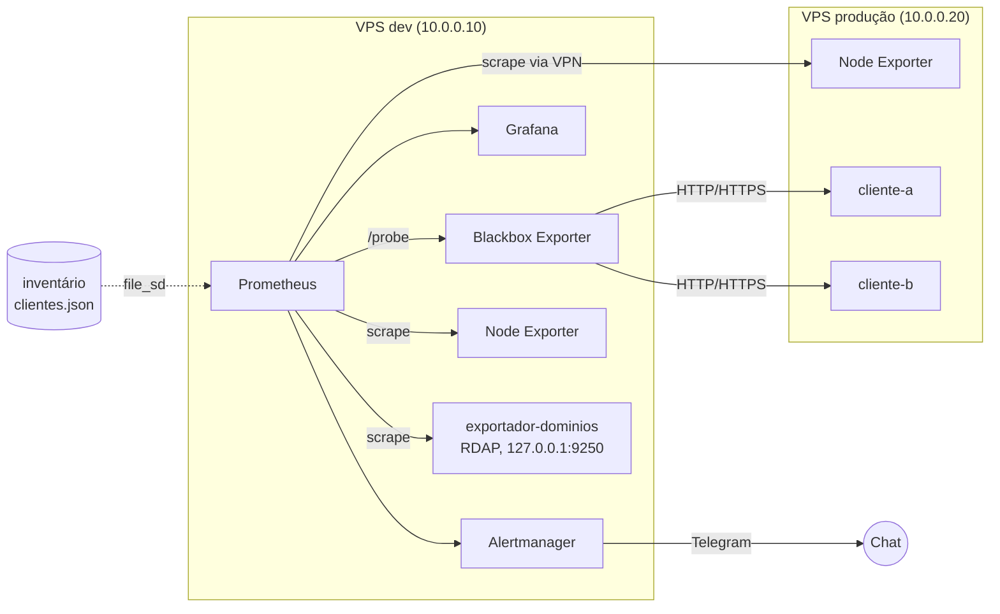

# observabilidade-vps

🇧🇷 Português · [🇬🇧 English below](#english)

Stack de observabilidade para duas VPS Linux e as instâncias de clientes que rodam nelas: **Prometheus, Alertmanager, Blackbox Exporter, Node Exporter e Grafana**, com 10 regras de alerta, um exportador próprio de vencimento de domínios e *drop-ins* de systemd.

> **Transparência:** o código e a configuração foram desenvolvidos com auxílio do Claude Code e revisados por mim. A escolha do stack, a instalação nas VPS e o ajuste das regras foram decisões e execuções minhas. Todos os nomes, IPs e domínios aqui são fictícios (`exemplo.com`, `10.0.0.x`).

## Problema

Não havia métrica histórica nem alerta: o único monitoramento era um *healthcheck* a cada 5 minutos, sem histórico. Duas falhas reais motivaram o desenho:

1. Os exporters de uma VPS ficaram `failed` por 9 dias depois de um boot e ninguém percebeu (corrida de boot com o Tailscale).
2. Um certificado ou domínio vencido derruba o site sem aviso.

## Arquitetura



## Decisões técnicas

1. **Prometheus + Grafana em vez de Zabbix.** Eu já conhecia o Zabbix, mas ele exige servidor próprio, banco relacional e frontend PHP, o que pesa para uma VPS e algumas instâncias. O Prometheus é um binário leve, com modelo *pull* e configuração em arquivo (versionável em git). O Zabbix fica como opção se a infra crescer para muitas VPS ou hosts heterogêneos (SNMP, equipamentos de rede, hosts de terceiros).
2. **`up == 0` como alerta de "monitor morto".** Alertas baseados em `probe_success` não disparam quando o próprio blackbox_exporter cai: a métrica some, em vez de virar 0. `up` é escrito pelo Prometheus em cada scrape e sempre existe.
3. **Drop-ins de systemd, não edição do unit do pacote.** O conserto da corrida com o `tailscaled` fica em `override.conf` e sobrevive a atualizações do pacote. `StartLimitIntervalSec=0` evita que o systemd desista após a rajada de falhas do boot.
4. **Exportador de domínios em loopback.** Escuta em `127.0.0.1`, justamente para não depender da interface da VPN, o padrão que causou o problema 1.
5. **RDAP, não WHOIS**, para ler a expiração do domínio: JSON estruturado, sem pacote extra nem root. O exportador guarda em cache a *data de expiração* (fato) e recalcula "dias restantes" a cada resposta; consulta o registrador no máximo a cada 12 h.
6. **Alvos de clientes gerados do inventário** (`file_sd`), nunca editados à mão.
7. **Certificado e domínio são alertas separados** (30 e 7 dias cada): vencem em datas diferentes e têm gravidade diferente.
8. **Probe de caixa-preta + métrica de caixa-branca.** O Blackbox mostra o que o usuário vê; o node_exporter mostra por quê.

## Como rodar

Requisitos: Debian/Ubuntu com `prometheus`, `prometheus-alertmanager`, `prometheus-blackbox-exporter`, `prometheus-node-exporter` e `grafana`.

```bash
# configuração (ajuste IPs e domínios antes)
sudo cp prometheus/prometheus.yml prometheus/alert.rules.yml prometheus/blackbox.yml /etc/prometheus/
sudo mkdir -p /etc/prometheus/targets && sudo cp prometheus/targets/clientes.example.json /etc/prometheus/targets/clientes.json
promtool check config /etc/prometheus/prometheus.yml
sudo systemctl reload prometheus

# alertas: copie alertmanager/alertmanager.yml.example para /etc/alertmanager/alertmanager.yml e preencha o token

# drop-ins (corrida de boot com a VPN)
sudo cp -r systemd/prometheus-*-exporter.service.d /etc/systemd/system/
sudo systemctl daemon-reload && sudo systemctl restart prometheus-node-exporter prometheus-blackbox-exporter

# exportador de domínios (systemd --user)
DOMINIOS=exemplo.com python3 exporters/dominios/exportador-dominios.py   # teste manual
```

Dashboards: importe `grafana/dashboards/clientes-uptime.json` (defina a variável de datasource). Para métricas de host use o dashboard comunitário *Node Exporter Full* (ID 1860 no grafana.com) e, para sondas, um dashboard comunitário de Blackbox; eu não os redistribuo aqui por serem de terceiros.

## Limitações conhecidas

- Não há medição de uptime publicada: nenhum número de disponibilidade é afirmado aqui.
- `ufw`/firewall de host não fazem parte do repositório; o *bind* na interface da VPN é a única restrição de exposição das portas dos exporters.
- O Alertmanager usa o template padrão do Telegram; formatação rica (estado, host, recomendações) ficou como melhoria.
- Só dois TLDs (`.com`, `.com.br`) estão mapeados no exportador de domínios; outros exigem acrescentar o servidor RDAP.
- Sem alta disponibilidade do Prometheus e sem retenção longa configurada.

---

<a name="english"></a>
# observabilidade-vps (English)

An observability stack for two Linux VPS and the customer instances running on them: **Prometheus, Alertmanager, Blackbox Exporter, Node Exporter and Grafana**, with 10 alert rules, a custom domain-expiry exporter and systemd drop-ins.

> **Disclosure:** this code and configuration were developed with the help of Claude Code and reviewed by me. Choosing the stack, installing it on the VPS and tuning the rules were my own decisions and work. All names, IPs and domains here are fictional (`exemplo.com`, `10.0.0.x`).

## Problem

There was no historical metric or alerting; the only monitoring was a 5-minute health check with no history. Two real failures shaped the design: (1) exporters on one VPS sat in `failed` for 9 days after a reboot because of a boot race with Tailscale, and nobody noticed; (2) an expired certificate or domain takes a site down without warning.

## Architecture

See the Mermaid diagram above. Prometheus scrapes node exporters on both VPS (over a private VPN), probes each customer instance through the Blackbox Exporter (targets generated from an inventory via `file_sd`), scrapes the domain-expiry exporter, and sends alerts to Telegram through Alertmanager.

## Technical decisions

1. **Prometheus + Grafana over Zabbix.** I already knew Zabbix, but it needs its own server, a relational database and a PHP frontend, which is heavy for one VPS and a handful of instances. Prometheus is a light pull-based binary with file-based config that lives in git. Zabbix stays an option if the fleet grows or becomes heterogeneous (SNMP, network gear, third-party hosts).
2. **`up == 0` as the "monitor is dead" alert.** Alerts on `probe_success` stay silent when the blackbox exporter itself is down, because the series disappears rather than becoming 0. `up` is written by Prometheus on every scrape, so it always exists.
3. **systemd drop-ins instead of editing the packaged unit**, so the fix for the `tailscaled` race survives package upgrades. `StartLimitIntervalSec=0` stops systemd from giving up after the boot-time burst of failures.
4. **Domain exporter bound to loopback**, so it does not depend on the VPN interface being up, the exact pattern behind problem 1.
5. **RDAP instead of WHOIS** for domain expiry: structured JSON, no extra package, no root. It caches the expiry *date* and recomputes "days left" per response; the registrar is queried at most every 12 h.
6. **Customer targets are generated from the inventory**, never hand-edited.
7. **Certificate and domain expiry are separate alerts** (30 and 7 days each): different dates, different severity.
8. **Black-box probes plus white-box metrics**: Blackbox shows what the user sees, node_exporter shows why.

## Running it

See the commands in the Portuguese section above (copy configs to `/etc/prometheus`, validate with `promtool`, install the drop-ins, run the exporter). For host metrics use the community *Node Exporter Full* dashboard (grafana.com ID 1860); it is third-party and not redistributed here.

## Known limitations

No published uptime figures; host firewall is out of scope; default Alertmanager Telegram template; only `.com` and `.com.br` RDAP servers are mapped; no Prometheus HA or long-term retention.

## License

MIT
